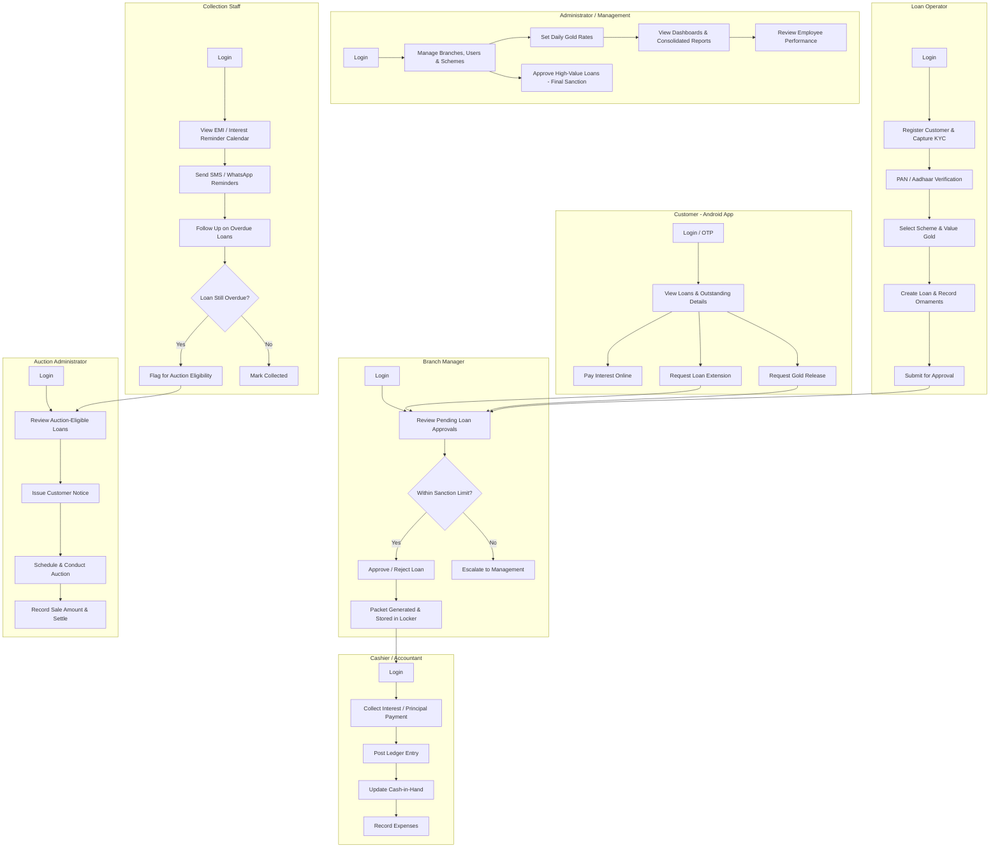

# Ambika Gold Finance — Project Overview

## What Ambika Gold Finance Is

Ambika Gold Finance is a Gold Loan Management system for a gold-loan
(pawnbroking) finance business. It manages the full lifecycle of lending
against pledged gold: customer onboarding and KYC, gold valuation, loan
creation and approval, ornament/packet tracking, interest and payment
collection, loan extension and gold release, bank re-pledging, and — for
defaulted loans — auction and final settlement.

## Why This Migration

Today Ambika Gold Finance exists as a **frontend-only prototype** with no
backend:

- `frontend/` — a Next.js admin web app (migrated from an earlier flat
  HTML/JS prototype, now kept under `frontend/legacy/`)
- No `mobile/` app yet — the customer-facing Android app has not been
  started

All "data" currently lives as mock JavaScript objects seeded into
`localStorage`, is scoped to a single browser, and has no real
persistence, KYC/PAN/Aadhaar verification, payment processing, or
authentication behind it. Business logic (gold valuation, LTV/eligible
loan calculation, interest and penal interest, packet/locker tracking,
auction eligibility) runs client-side against in-memory mock arrays with
no single source of truth.

This project introduces a single `backend/` service (Go + GORM +
PostgreSQL) that owns all data and business logic, serving both the REST
API and the built admin web app on one port, and refactors the frontend
(plus the future mobile app) into a pure API consumer. See
[architecture.md](architecture.md) for the technical design.

## Core Business Flow

```
Customer Registration & KYC → Gold Valuation → Scheme-Based Loan Calculation
   → Loan Creation & Ornament Pledge → Approval Workflow → Packet & Locker Storage
   → Interest & Payment Collection → [optional] Bank Re-Pledge
   → Loan Extension or Gold Release Request → Closure
   → [if defaulted] Auction Eligible → Auctioned → Final Settlement
```

Supporting flows: cash-in-hand & expense tracking, EMI/interest reminder
calendar with SMS/WhatsApp communication, employee performance reporting,
and multi-branch consolidated reporting.

## User Roles

| Role | Description |
|---|---|
| **Administrator** | Full system access: manages users, branches, schemes, gold rates; can override/approve sensitive actions |
| **Management** | Oversight access: views consolidated dashboards, reports, and approvals across branches |
| **Branch Manager** | Approves loans within configured sanction limits for their branch; supervises branch staff |
| **Loan Operator** | Registers customers, records KYC, creates loans, records ornament/purity details |
| **Cashier** | Collects payments, manages daily cash-in-hand |
| **Accountant** | Manages expenses, ledger entries, financial reporting |
| **Collection Staff** | Handles customer follow-ups, reminders, and collections for due/overdue loans |
| **Auction Administrator** | Manages the auction workflow for defaulted loans |
| **Auditor** | Read access to audit logs and reports for compliance review |
| **Customer** | Uses the Android app to view loans, pay interest, request extension/gold release, update KYC |

## User Workflow by Role (Mermaid)



## Key Business Logic

- **Gold Valuation & LTV** — Gross Gold Value = Gold Weight × Applicable
  Gold Rate (per karat); Eligible Loan Amount = Gross Gold Value × Scheme
  LTV %.
- **Multi-level Loan Approval** — a loan is made by a Loan Operator, then
  verified by the Loan Operator → approved by the Branch Manager → finally
  sanctioned by Management, so no loan is ever single-employee sanctioned.
  Per-role sanction limits are advisory: they warn the reviewer, never
  block the decision.
- **Interest & Penal Interest** — interest accrues per the selected
  scheme's method; configurable penal interest is automatically applied
  to overdue loans.
- **Packet & Locker Tracking** — pledged ornaments are grouped into a
  QR/barcode-tracked packet with a full movement history: Loan Created →
  Packet Generated → Locker Stored → Bank Pledged → Returned → Ready for
  Release → Released.
- **Gold Release Settlement** — Principal + Interest + Penal Interest +
  Applicable Charges − Payments/Waivers = Final Settlement Amount.
- **Auction Workflow** — Overdue → Default → Auction Eligible → Notice
  Issued → Auction Scheduled → Auctioned → Settled, with surplus/shortfall
  calculated and recorded after sale.
- **Bank Re-Pledge** — a loan's pledged gold may itself be re-pledged with
  an external bank; loans are flagged Not Pledged or Bank Pledged.

## Scope Constraints (v1)

- **Android only** — no iOS customer app in scope.
- KYC/PAN/Aadhaar verification depends on an authorized third-party
  provider (not yet selected/integrated).
- No payment gateway integration yet — online interest payment depends on
  provider selection.
- Currently a **single database** design (no per-branch database
  sharding); multi-branch support is modeled via `branch_id` scoping.

See [architecture.md](architecture.md), [database_architecture.md](database_architecture.md),
[api_documentation.md](api_documentation.md), and [context.md](context.md)
for further detail.
